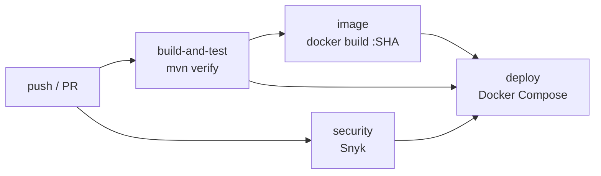

# LogiFast-Envios — Microservicio de Envíos

Microservicio correspondiente al **caso 17 — LogiFast**, una plataforma de transporte y logística de última milla. Este repositorio contiene el servicio de envíos desarrollado con Spring Boot y preparado para su construcción, ejecución y validación mediante herramientas de desarrollo Cloud Native.

| | |
|---|---|
| **Asignatura** | JVY0101 — Java: Diseño y Construcción de Soluciones Nativas en Nube |
| **Stack** | Spring Boot 4.0.8, Java 21, Maven, Spring Data JPA, H2 / PostgreSQL y springdoc-openapi |
| **Calidad** | Pruebas automatizadas, Cucumber y JaCoCo |
| **Contenedores** | Docker y Docker Compose (balanceador nginx, réplicas y PostgreSQL) |
| **CI/CD** | GitHub Actions, Snyk, Dependabot y despliegue automático trazable por SHA |

## Responsabilidad del microservicio (SRP)

Este microservicio administra los datos y la lógica del dominio de **Envíos** de LogiFast.

Utiliza una base de datos **H2 en memoria**, manteniendo los datos aislados dentro del dominio del servicio.

Al ser una base de datos en memoria, los datos no deben considerarse persistentes después de reiniciar la aplicación.

## Página de presentación y documentación de la API

Al ejecutar el servicio en el puerto 8080, la página principal estará disponible en:

`http://localhost:8080/`

La página presenta información del microservicio y proporciona enlaces a las siguientes herramientas:

- **Swagger UI:** `http://localhost:8080/swagger-ui/index.html`
- **OpenAPI (YAML):** `http://localhost:8080/v3/api-docs.yaml`
- **ReDoc:** `http://localhost:8080/redoc.html`
- **Consola H2:** `http://localhost:8080/h2-console`

## Endpoints REST

| Método | Ruta | Descripción |
|---|---|---|
| GET | `/api/envios` | Lista todos los envíos. |
| GET | `/api/envios/{id}` | Obtiene un envío por su identificador. |
| POST | `/api/envios` | Crea un envío. |
| PUT | `/api/envios/{id}` | Actualiza un envío existente. |
| DELETE | `/api/envios/{id}` | Elimina un envío. |

### Ejemplo de creación

```bash
curl -i -X POST http://localhost:8080/api/envios \
  -H "Content-Type: application/json" \
  -d '{"nombre":"Envio de prueba EP2"}'
```

La respuesta concreta depende de las validaciones y de la implementación del servicio.

## Monitoreo y estado del servicio

El proyecto incorpora **Spring Boot Actuator** para consultar el estado de salud de la aplicación.

| Método | Ruta | Descripción |
|---|---|---|
| GET | `/actuator/health` | Consulta el estado de salud del servicio. |
| GET | `/actuator/health/liveness` | Indica si el proceso está vivo. |
| GET | `/actuator/health/readiness` | Indica si el servicio está listo para recibir tráfico (incluye la base de datos). Lo usa el healthcheck de Docker Compose. |
| GET | `/actuator/info` | Nombre, versión, **commit** e instancia que respondió (trazabilidad del despliegue). |

Solo se exponen `health` e `info`; el resto de los endpoints de Actuator no está publicado.

Para comprobar el endpoint cuando la aplicación se encuentra ejecutándose localmente en el puerto 8080:

```bash
curl -i http://localhost:8080/actuator/health
```

Una respuesta satisfactoria devuelve HTTP 200 y un JSON similar a:

```json
{
  "status": "UP"
}
```

**Validación realizada:** el endpoint respondió HTTP 200 con `{"status":"UP"}` durante la prueba de la imagen Docker `logifast-envios:ep2`, utilizando el puerto 8081 del equipo para evitar interferir con otros servicios.

El estado `UP` confirma que la aplicación reporta un estado operativo; no implica por sí solo que se hayan comprobado todas las dependencias externas.

## Documentación del proyecto

La documentación complementaria se encuentra en la carpeta [`docs/`](docs/):

- [`docs/00_Resumen.md`](docs/00_Resumen.md): propósito, responsabilidad y tecnologías.
- [`docs/01_Arquitectura.md`](docs/01_Arquitectura.md): componentes, arquitectura y patrones.
- [`docs/02_API.md`](docs/02_API.md): contrato REST y ejemplos con `curl`.
- [`docs/03_Pruebas.md`](docs/03_Pruebas.md): pruebas unitarias, cobertura y Cucumber.
- [`docs/04_Despliegue.md`](docs/04_Despliegue.md): instrucciones de despliegue.
- [`docs/05_Justificacion.md`](docs/05_Justificacion.md): justificación del servicio, RF/RNF, seguridad, stack tecnológico y tecnologías AWS.
- [`docs/06_Seguridad_Escalabilidad.md`](docs/06_Seguridad_Escalabilidad.md): Dependabot, Snyk, política de bloqueo y parámetros de escalabilidad (IE3).
- [`docs/07_CICD_Despliegue.md`](docs/07_CICD_Despliegue.md): pipeline, despliegue automático, trazabilidad y prueba de bloqueo (IE4).
- [`docs/08_Orquestacion.md`](docs/08_Orquestacion.md): Docker Compose con balanceador, réplicas, healthchecks, escalado y comandos (IE5).
- [`evidencias/`](evidencias/): capturas y logs de cada indicador.
- [`docs/diagramas/`](docs/diagramas/): diagramas C4 de contexto, contenedores y componentes, secuencia e infraestructura AWS, además de diagramas de Docker, Docker Compose e integración.

## Estructura del proyecto

```text
LogiFast-Envios/
├── src/
│   ├── main/
│   │   ├── java/
│   │   └── resources/
│   └── test/
│       ├── java/
│       └── resources/
├── docs/
│   ├── 00_Resumen.md
│   ├── 01_Arquitectura.md
│   ├── 02_API.md
│   ├── 03_Pruebas.md
│   ├── 04_Despliegue.md
│   ├── 05_Justificacion.md
│   └── diagramas/
├── .github/
│   ├── workflows/
│   │   └── ci.yml            # pipeline CI/CD
│   └── dependabot.yml        # actualización de dependencias
├── deploy/nginx/default.conf # balanceador de carga
├── scripts/
│   ├── deploy.sh             # despliegue (pipeline y local)
│   ├── verify-deploy.sh      # verificación post-deploy
│   └── test-scaling.sh       # prueba de escalado y autorrecuperación
├── evidencias/               # capturas y logs por indicador
├── Dockerfile
├── docker-compose.yml
├── .env.example
├── pom.xml
├── README.md
└── .gitignore
```

## Cómo ejecutar localmente

La ejecución directa con Maven requiere tener Java 21 y Maven instalados.

Para iniciar el microservicio:

```bash
mvn spring-boot:run
```

Una vez iniciado, estará disponible en:

`http://localhost:8080`

## Cómo ejecutar con Docker

El proyecto utiliza un Dockerfile multi-stage para separar la construcción de la aplicación de su ejecución.

### Características del Dockerfile

**Etapa de construcción:**

- Utiliza Maven 3.9 y Eclipse Temurin 21.
- Descarga las dependencias.
- Compila y empaqueta la aplicación Spring Boot.

**Etapa de ejecución:**

- Utiliza una imagen Eclipse Temurin 21 JRE.
- Copia el artefacto JAR generado en la etapa de construcción.
- Ejecuta la aplicación con el usuario sin privilegios `app`.
- Expone el puerto 8080 del contenedor.

Este enfoque evita incluir Maven y todas las herramientas de compilación en la imagen final y permite ejecutar la aplicación sin utilizar el usuario `root`.

### Construir y levantar el entorno con Docker Compose

`docker-compose.yml` levanta un **balanceador nginx** (único puerto publicado),
**2 réplicas** del microservicio y **PostgreSQL** compartido, con healthchecks y
límites de CPU y memoria. Detalle en [`docs/08_Orquestacion.md`](docs/08_Orquestacion.md).

Desde la raíz del repositorio:

```bash
docker compose up --build -d --wait
```

`--wait` espera a que la base de datos, las réplicas y el balanceador estén *healthy*.

Consultar el estado de los servicios:

```bash
docker compose ps
```

Consultar los registros del microservicio:

```bash
docker compose logs -f envios-svc
```

Probar la aplicación y su estado de salud:

```bash
curl -i http://localhost:8080/
curl -i http://localhost:8080/actuator/health
curl http://localhost:8080/actuator/info      # versión, commit e instancia que respondió
```

Verificación completa y prueba de escalado (requieren `bash`, `curl` y `jq`; en Windows, Git Bash o WSL):

```bash
./scripts/verify-deploy.sh
./scripts/test-scaling.sh
```

Escalar manualmente:

```bash
docker compose up -d --scale envios-svc=3 --wait
```

Detener los servicios:

```bash
docker compose down        # agregar -v para borrar también los datos de PostgreSQL
```

`docker compose down` detiene y elimina los contenedores, pero no elimina el volumen
`db-data`; para eso se usa `-v`.

En el entorno Compose la consola H2 queda deshabilitada, porque los datos viven en
PostgreSQL para que todas las réplicas compartan el mismo estado.

### Configuración del puerto

El balanceador publica el puerto del equipo mediante la variable `PORT`:

```yaml
lb:
  ports:
    - "${PORT:-8080}:80"
```

Si no se define `PORT`, se utiliza el puerto 8080 del equipo. Las réplicas del
microservicio no publican puertos; solo se accede a ellas a través del balanceador.
Las demás variables están en [`.env.example`](.env.example).

### Etiquetas de las imágenes Docker

El repositorio utiliza distintas etiquetas según el procedimiento de construcción:

- **Docker Compose en local:** `duoc/jv0101-caso17-envios:1.0.0` (configurable con `IMAGE_TAG`).
- **Pruebas locales de la EP2:** `logifast-envios:ep2`.
- **Pipeline CI/CD:** `duoc/jv0101-caso17-envios:<sha7>` y `duoc/jv0101-caso17-envios:<versión>-<sha7>`, donde `<sha7>` es el SHA corto del commit.

Estas etiquetas identifican imágenes diferentes. La imagen `logifast-envios:ep2` se construyó correctamente durante las pruebas locales y presentó un uso en disco de 564 MB y un tamaño de contenido de 166 MB en el entorno donde se midió. Estos valores pueden variar según la versión de Docker y la plataforma.

## Pruebas automatizadas y cobertura

El proyecto incorpora pruebas automatizadas para validar el comportamiento de la aplicación y verificar la cobertura del código.

### Ejecutar las pruebas

Para ejecutar las pruebas unitarias y de comportamiento con Cucumber:

```bash
mvn test
```

Para ejecutar las pruebas y las verificaciones configuradas:

```bash
mvn verify
```

El objetivo `verify` permite ejecutar las fases anteriores del ciclo de Maven y comprobar los umbrales de cobertura configurados mediante JaCoCo.

### Ejecución mediante Docker

Si Maven no está instalado directamente en Windows, se puede utilizar un contenedor Maven para ejecutar la verificación desde la raíz del proyecto.

En **CMD de Windows**:

```cmd
docker run --rm -v "%cd%:/app" -w /app maven:3.9-eclipse-temurin-21 mvn verify
```

En PowerShell, la ruta del volumen puede expresarse de esta forma:

```powershell
docker run --rm -v "${PWD}:/app" -w /app maven:3.9-eclipse-temurin-21 mvn verify
```

### Evidencia de ejecución

Durante la validación de la EP2, `mvn verify` finalizó con:

```text
BUILD SUCCESS
All coverage checks have been met.
```

JaCoCo informó que analizó cuatro clases y que se cumplieron todos los umbrales configurados.

En el reporte de cobertura generado durante esa ejecución se registró un 100 % en las métricas de instrucciones, ramas, líneas y métodos para el conjunto analizado. Este resultado corresponde al alcance del análisis de JaCoCo y no garantiza por sí solo la ausencia de defectos.

El reporte HTML se genera en:

```text
target/site/jacoco/index.html
```

## Pipeline CI/CD

El pipeline está en [`.github/workflows/ci.yml`](.github/workflows/ci.yml).

### Eventos que activan el workflow

- Un `push` a `develop` o a `main`.
- Un Pull Request dirigido a `develop` o a `main` (incluidos los de Dependabot).
- Ejecución manual desde la pestaña *Actions* (`workflow_dispatch`).

### Etapas del pipeline



| Etapa (job) | IE | Qué hace | Bloquea el deploy si… |
|---|---|---|---|
| `build-and-test` | IE2 | Descarga el repositorio, configura Java 21, ejecuta `mvn verify` (JUnit, Cucumber, JaCoCo) y publica los reportes | falla una prueba o no se cumple la cobertura |
| `Seguridad (Snyk)` | IE3 | Snyk Open Source (dependencias) y Snyk Code (análisis estático); publica hallazgos y registra el proyecto para alertas | hay vulnerabilidades **high/critical** o falta `SNYK_TOKEN` |
| `Imagen Docker (build + escaneo)` | IE1 · IE4 | Construye la imagen con el `Dockerfile`, etiquetada con el SHA del commit y labels OCI; Snyk Container como alerta | la imagen no compila |
| `Deploy (entorno simulado)` | IE4 · IE5 | Despliega con Docker Compose la misma imagen construida, verifica salud, commit y API, prueba el escalado y guarda evidencias | — (falla si la verificación falla) |

El job `deploy` declara `needs: [build-and-test, security, image]`: si las pruebas
o el análisis de seguridad fallan, **no se despliega**.

### Seguridad (IE3)

- **Dependabot** (`.github/dependabot.yml`): revisa semanalmente Maven, GitHub
  Actions, las imágenes del `Dockerfile` y de `docker-compose.yml`, y abre Pull Requests hacia `develop`.
- **Snyk**: análisis de dependencias y de código en cada ejecución, con umbral de
  bloqueo `high`. El escaneo de la imagen genera alertas sin bloquear.
- **Contenedores endurecidos**: usuario sin privilegios `app` (Dockerfile),
  sistema de archivos de solo lectura, sin capacidades de Linux, base de datos en
  red interna, solo `health` e `info` expuestos.
- **Remediación guiada por Snyk:** el primer análisis bloqueó el pipeline con 27
  vulnerabilidades (3 críticas) en Spring Framework 6.2, Tomcat, Jackson, Logback,
  Micrometer y el driver de PostgreSQL. Spring Boot 3.5 ya no recibe correcciones
  gratuitas, así que el proyecto se migró a **Spring Boot 4.0.8** (Spring Framework 7,
  springdoc 3.0.3, Cucumber 7.34.9) y se forzaron versiones corregidas de Tomcat,
  Jackson 2 y PostgreSQL en el `pom.xml`. La única vulnerabilidad sin corrección
  publicada (JAXB, usada internamente por Hibernate) queda como excepción auditada y
  con fecha de expiración en [`.snyk`](.snyk).

Política completa y configuración de secretos: [`docs/06_Seguridad_Escalabilidad.md`](docs/06_Seguridad_Escalabilidad.md).

### Escalabilidad (IE3 · IE5)

| Parámetro | Valor |
|---|---|
| Réplicas | 2 (configurable con `APP_REPLICAS`; probado con 3) |
| CPU por réplica | límite 0.75, reserva 0.25 |
| Memoria por réplica | límite 512M, reserva 256M, heap JVM 60% |
| Conexiones a la base / hilos de Tomcat | 10 / 100 por réplica |
| Balanceo | nginx round-robin, con reintento en otra réplica y detección dinámica de réplicas |

### Despliegue y trazabilidad (IE4)

1. Cada imagen se etiqueta con el **SHA corto del commit** y lleva labels OCI
   (`revision`, `version`, `source` y el enlace al run de Actions).
2. El job `deploy` no reconstruye: descarga y despliega **la misma imagen** que
   se construyó y analizó en el run.
3. La aplicación informa el commit en ejecución en `GET /actuator/info`, y
   `verify-deploy.sh` exige que coincida con el commit del pipeline.
4. Cada despliegue queda registrado en la pestaña *Deployments* (entornos
   `simulado` y `preview`), en el resumen del run y en el artefacto
   `evidencia-deploy-<sha7>` (registro JSON, logs, `docker compose ps`, `docker stats`).
5. GitFlow con Pull Requests revisados conecta cada despliegue con el cambio que
   lo originó y con quién lo aprobó.

Verificaciones automáticas después del despliegue: health, liveness y readiness
en `UP`; commit correcto; todas las réplicas con la imagen correcta y *healthy*;
límites de recursos aplicados; CRUD completo a través del balanceador; validación
(400); y endpoints sensibles no expuestos. Detalle en [`docs/07_CICD_Despliegue.md`](docs/07_CICD_Despliegue.md).

### Cómo se garantiza la calidad

- Pull Request obligatorio y revisión del otro integrante antes de integrar a `develop` o `main`.
- Checks requeridos: pruebas, seguridad, imagen y despliegue en verde.
- Cobertura JaCoCo con los umbrales configurados y pruebas BDD de los endpoints;
  las pruebas incluyen los endpoints de salud (`ActuatorEndpointsTest`) de los que
  dependen el healthcheck y la verificación del despliegue.
- El despliegue solo se considera exitoso si la verificación automática pasa.

## Estrategia de ramificación

Este repositorio utiliza **GitFlow** como modelo de ramificación.

Se eligió este modelo porque el equipo trabaja en pareja y necesita ramas separadas para desarrollar y probar cambios sin afectar directamente las ramas principales.

GitFlow permite:

- Mantener `main` como rama estable.
- Integrar los cambios en `develop`.
- Desarrollar funcionalidades mediante ramas `feature/*`.
- Corregir problemas urgentes mediante ramas `hotfix/*`.
- Mantener trazabilidad mediante commits y Pull Requests.

Trunk-Based Development puede ser conveniente para equipos con integración muy frecuente y despliegues continuos. Para este proyecto, GitFlow permite demostrar el trabajo colaborativo, la revisión de cambios y la separación entre desarrollo y código estable.

### Comparación con otros modelos

| Modelo | Característica | Aplicabilidad |
|---|---|---|
| GitFlow | Utiliza ramas como `main` y `develop`, además de ramas `feature` y `hotfix`. | Adecuado cuando se necesita separar desarrollo, integración y versiones estables. |
| GitHub Flow | Utiliza una rama principal y ramas de trabajo integradas mediante Pull Requests. | Adecuado para equipos que realizan cambios frecuentes y buscan un flujo más simple. |
| Trunk-Based Development | Integra cambios pequeños y frecuentes en una rama principal. | Adecuado para equipos con integración continua y despliegues frecuentes. |

Para esta evaluación se utiliza GitFlow, de acuerdo con la organización de ramas establecida para el proyecto.

### Ramas del repositorio

| Rama | Propósito |
|---|---|
| `main` | Código estable y preparado para la entrega o despliegue. |
| `develop` | Integración del trabajo en curso antes de pasar a `main`. |
| `feature/<nombre>` | Desarrollo de nuevas funcionalidades. Nace de `develop` y vuelve a `develop` mediante Pull Request. |
| `hotfix/<nombre>` | Corrección urgente. Según el flujo definido para el proyecto, nace de `main` y se integra a `main` y `develop` mediante Pull Requests. |

### Convención de nombres de ramas

Se utiliza el siguiente formato:

```text
feature/nombre-corto-en-minusculas
hotfix/nombre-corto-en-minusculas
```

Ejemplos:

```text
feature/rocio-documentacion
feature/martin-ci
feature/ep2-healthcheck
hotfix/corregir-validacion-envio
```

### Convención de mensajes de commit

Se utiliza el formato **Conventional Commits**:

```text
feat: agrega nueva funcionalidad
fix: corrige un error
docs: actualiza la documentación
chore: realiza tareas de mantenimiento
ci: modifica la integración continua
test: agrega o modifica pruebas
refactor: reorganiza el código sin cambiar su comportamiento
```

### Flujo de merge y revisión

1. Las ramas `feature/*` y `hotfix/*` se integran mediante Pull Requests, evitando el push directo a las ramas principales.
2. Cada Pull Request debe ser revisado por el otro integrante antes del merge.
3. Las ramas `feature/*` se integran a `develop`.
4. Las ramas `hotfix/*` siguen el flujo definido para su integración en `main` y `develop`.
5. Después de integrar una rama, se puede eliminar para mantener el repositorio organizado.

## Control de versiones

El código fuente se administra mediante **Git y GitHub**.

Se mantiene una separación entre las ramas principales:

- `main`: código estable.
- `develop`: integración de cambios.
- `feature/*`: desarrollo de funcionalidades.
- `hotfix/*`: correcciones urgentes.

Cada modificación queda asociada a un commit identificable y, cuando corresponde, a un Pull Request.

### Buenas prácticas

- No realizar `push` directo a `main` ni a `develop`.
- Utilizar ramas `feature/*` para nuevas funcionalidades.
- Utilizar ramas `hotfix/*` para correcciones urgentes.
- Mantener los commits pequeños y relacionados con un único objetivo.
- Utilizar mensajes de commit descriptivos.
- Revisar los Pull Requests antes del merge.
- Ejecutar las pruebas antes de solicitar un Pull Request.
- No almacenar credenciales ni información sensible en el repositorio.
- Mantener actualizado el código local mediante `git pull`.
- Eliminar las ramas de trabajo después de completar su integración.

## Uso de herramientas de Inteligencia Artificial

Durante el desarrollo de esta evaluación se utilizó ChatGPT como herramienta de apoyo para resolver dudas técnicas, revisar configuraciones de Docker y GitHub Actions, interpretar resultados de pruebas y organizar la documentación.

Las decisiones finales, la comprobación de los comandos y la validación del funcionamiento del proyecto se realizaron contrastando las sugerencias con el repositorio y los resultados obtenidos.

Para los indicadores IE3, IE4 e IE5 se utilizó además Claude (Anthropic) como apoyo para proponer la configuración de Dependabot y Snyk, el job de despliegue, el archivo Docker Compose con balanceador y los scripts de verificación, y para redactar una primera versión de la documentación técnica (`docs/06` a `docs/08`). Las configuraciones fueron revisadas, ejecutadas en GitHub Actions y ajustadas por el equipo. Las reflexiones individuales se redactaron sin IA. Referencia: Anthropic. (2026). *Claude* [Modelo de lenguaje]. https://claude.ai

## Reflexiones individuales

### Rocío
Durante el proyecto LogiFast, lo que más me costó fue identificar qué pasos debía agregar al workflow de GitHub Actions. Ejecutar el pipeline me ayudó a comprender mejor cómo se automatizan las pruebas con Maven y la construcción de la imagen Docker. Aunque aprendí más sobre su funcionamiento, todavía necesito practicar para poder configurar un workflow desde cero de forma autónoma.

### Martín


## Estado de la entrega

| Indicador | Estado | Evidencia |
|---|---|---|
| IE1 — Contenedores | Dockerfile multi-stage con usuario sin privilegios; imagen construida en el pipeline | `Dockerfile`, job `image` |
| IE2 — Pruebas | `mvn verify` con JUnit, Cucumber y JaCoCo en cada ejecución | job `build-and-test`, artefacto `reportes-pruebas-<sha>` |
| IE3 — Seguridad y escalabilidad | Dependabot, Snyk con bloqueo, límites y réplicas | [`docs/06`](docs/06_Seguridad_Escalabilidad.md), [`evidencias/IE3`](evidencias/IE3) |
| IE4 — Despliegue y trazabilidad | Deploy automático condicionado, imagen por SHA, verificación post-deploy | [`docs/07`](docs/07_CICD_Despliegue.md), [`evidencias/IE4`](evidencias/IE4) |
| IE5 — Orquestación | Docker Compose con balanceador, réplicas, healthchecks y límites | [`docs/08`](docs/08_Orquestacion.md), [`evidencias/IE5`](evidencias/IE5) |
