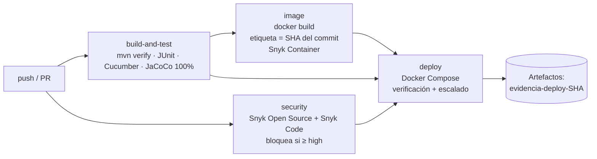

# Envios — Pipeline CI/CD, despliegue y trazabilidad (IE4)

Workflow: [`.github/workflows/ci.yml`](../.github/workflows/ci.yml)

## 1. Etapas



| Job | Depende de | Falla si… | Produce |
|---|---|---|---|
| `build-and-test` | — | una prueba falla o la cobertura baja de 100% | `reportes-pruebas-<sha>` (JaCoCo, Surefire, Cucumber) |
| `security` | — | Snyk encuentra vulnerabilidades ≥ high, o falta `SNYK_TOKEN` | `reportes-snyk-<sha>`, hallazgos en *Security* |
| `image` | `build-and-test` | la imagen no compila | `imagen-docker-<sha7>` (la imagen exacta que se despliega) |
| `deploy` | `build-and-test`, `security`, `image` | cualquier verificación post-deploy falla | `evidencia-deploy-<sha7>`, entrada en *Deployments* |

Disparadores: `push` a `develop` y `main`, Pull Request hacia `main` y `develop`
(incluidos los de Dependabot) y ejecución manual (`workflow_dispatch`).
En los PR el deploy corre en el entorno `preview`; en `push`, en `simulado`.

## 2. Despliegue en el entorno simulado

El "entorno cloud simulado" es un stack de Docker Compose que reproduce la
arquitectura objetivo en AWS:

| AWS (diseño) | Entorno simulado |
|---|---|
| Application Load Balancer, health check `/actuator/health` | `lb` (nginx) con healthcheck propio y reparto entre réplicas |
| Servicio ECS Fargate con 2+ tareas | `envios-svc` con `deploy.replicas: 2`, límites de CPU/memoria |
| Base de datos administrada (Aurora PostgreSQL) | `db` (PostgreSQL 16) en red interna |

Pasos del job `deploy` (los mismos scripts sirven en local):

1. Descarga el artefacto `imagen-docker-<sha7>` y lo carga con `docker load`.
   **No se reconstruye**: se despliega exactamente la imagen construida en `image`.
2. Genera una clave aleatoria para la base de datos (enmascarada en los logs).
3. `scripts/deploy.sh` → `docker compose up -d --no-build --wait`: termina solo
   cuando la base, las réplicas y el balanceador están *healthy*.
4. `scripts/verify-deploy.sh` comprueba:
   - `/actuator/health`, `/liveness` y `/readiness` = `UP`;
   - `/actuator/info` informa **el mismo commit** que disparó el pipeline;
   - todas las réplicas usan la imagen con la etiqueta `<sha7>`;
   - réplicas *healthy* y límites de CPU/memoria aplicados;
   - CRUD completo por el balanceador (201 → 200 → 200 → 204 → 404) y validación (400);
   - `/actuator/env` y `/h2-console` no expuestos (404).
5. `scripts/test-scaling.sh` escala a 3 réplicas, verifica reparto de carga,
   tumba una réplica y comprueba que el servicio sigue respondiendo y que la
   réplica se recupera sola (detalle en [08_Orquestacion.md](08_Orquestacion.md)).
6. Guarda el registro del despliegue y apaga el entorno.

## 3. Trazabilidad de punta a punta

```
commit (SHA) ─► run de Actions (#run_id) ─► imagen :<sha7> + :<versión>-<sha7>
                                                 │  labels OCI: revision=<SHA>, version, source, run
                                                 ▼
                               contenedor en ejecución ─► GET /actuator/info → "commit": "<SHA>"
                                                 ▼
                       00-registro-despliegue.json + entrada en GitHub "Deployments"
```

| Pregunta | Dónde se responde |
|---|---|
| ¿Qué commit está desplegado? | `GET /actuator/info` → `app.commit`; resumen del job `deploy` |
| ¿De qué run salió esta imagen? | `docker inspect` → label `cl.duoc.pipeline.run` |
| ¿Qué cambió y quién lo aprobó? | PR asociado al commit (GitFlow: `feature/*` → `develop` → `main`) |
| ¿Qué pruebas y análisis pasó? | Artefactos `reportes-pruebas-<sha>` y `reportes-snyk-<sha>` del mismo run |
| ¿Cuándo y dónde se desplegó? | Pestaña *Deployments* (entornos `simulado`/`preview`) y `00-registro-despliegue.json` |

Versiones: el número de versión viene del `pom.xml` (`1.0.0`). Al publicar una
versión se crea el tag Git correspondiente sobre `main`:
`git tag -a v1.0.0 -m "Release 1.0.0" && git push origin v1.0.0`.

## 4. Cómo se garantiza la calidad

- Nada llega a `develop` ni a `main` sin Pull Request revisado y checks en verde.
- Las pruebas (JUnit + Cucumber) y la cobertura JaCoCo al **100% de líneas** son
  obligatorias (`mvn verify` falla si baja).
- Las pruebas incluyen los endpoints de salud (`ActuatorEndpointsTest`), porque el
  healthcheck y la verificación post-deploy dependen de ellos.
- El análisis de seguridad es bloqueante (ver [06_Seguridad_Escalabilidad.md](06_Seguridad_Escalabilidad.md)).
- El despliegue se verifica automáticamente: si la aplicación no queda sana o no
  corre el commit esperado, el run queda en rojo.

## 5. Prueba del bloqueo de seguridad

Para evidenciar que el pipeline se detiene ante una vulnerabilidad (hacerlo una
vez y **no** mergear):

```bash
git checkout develop && git pull
git checkout -b test/bloqueo-seguridad
```

Agregar al `pom.xml`, dentro de `<dependencies>`, una dependencia con una
vulnerabilidad crítica conocida (Log4Shell):

```xml
<dependency>
    <groupId>org.apache.logging.log4j</groupId>
    <artifactId>log4j-core</artifactId>
    <version>2.14.1</version>
</dependency>
```

```bash
git commit -am "test: dependencia vulnerable para probar bloqueo de Snyk"
git push -u origin test/bloqueo-seguridad
```

Abrir un PR hacia `develop`. Resultado esperado: `Seguridad (Snyk)` en rojo
(Critical: Remote Code Execution) y `Deploy (entorno simulado)` **skipped**.
Capturar pantalla del run y del resumen; luego cerrar el PR y borrar la rama.

## 6. Rollback

Como cada imagen queda identificada por su SHA, volver a una versión anterior es
desplegar esa etiqueta:

```bash
IMAGE_TAG=<sha7-anterior> GIT_COMMIT=<sha-anterior> SKIP_BUILD=1 ./scripts/deploy.sh
```

o revertir el commit (`git revert`) y dejar que el pipeline despliegue de nuevo.
