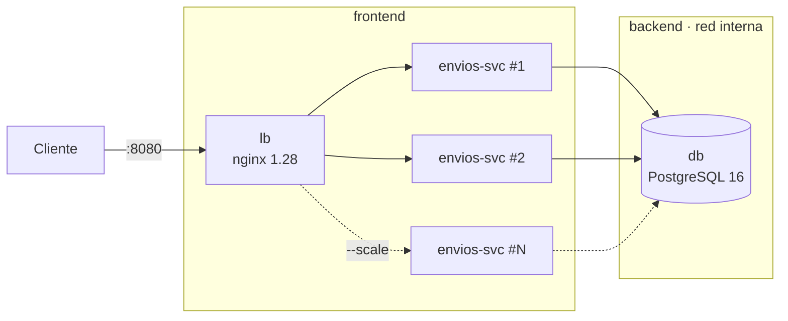

# Envios — Orquestación de contenedores con Docker Compose (IE5)

Archivo: [`docker-compose.yml`](../docker-compose.yml) · balanceador: [`deploy/nginx/default.conf`](../deploy/nginx/default.conf)

## 1. Arquitectura



| Servicio | Imagen | Rol | Healthcheck |
|---|---|---|---|
| `lb` | `nginx:1.28-alpine` | Único punto de entrada; reparte en round-robin entre réplicas, reintenta en otra si una falla | `GET /lb-health` |
| `envios-svc` | `duoc/jv0101-caso17-envios:<sha7>` | Microservicio (2 réplicas por defecto) | `GET /actuator/health/readiness` (app + base de datos) |
| `db` | `postgres:16-alpine` | Base compartida por las réplicas, con volumen persistente | `pg_isready` |

### Por qué una base compartida

Con H2 en memoria cada réplica tendría sus propios datos: un envío creado en
la réplica 1 no existiría en la 2, y el balanceador devolvería 404 la mitad de
las veces. Para que el servicio escale horizontalmente debe ser *stateless*, así
que en el entorno orquestado el estado vive en PostgreSQL (simula la base
administrada de AWS). En desarrollo (`mvn spring-boot:run`) y en las pruebas se
sigue usando H2 en memoria, sin cambios.

### Orden de arranque

`db` (healthy) → `envios-svc` (healthy) → `lb`. Se controla con
`depends_on: condition: service_healthy`, así el balanceador nunca recibe
tráfico antes de que haya réplicas listas.

### Autorrecuperación

- `restart: unless-stopped` en los tres servicios.
- `-XX:+ExitOnOutOfMemoryError`: si una réplica se queda sin memoria, termina y Docker la reinicia.
- nginx vuelve a resolver el DNS de Docker cada 5 s (`server envios-svc:8080 resolve`):
  detecta réplicas nuevas o reiniciadas sin reiniciarse. Si una réplica no responde,
  la saca de rotación 10 s (`max_fails=1 fail_timeout=10s`) y reintenta la petición en otra.

Límites de recursos y parámetros de escalado: ver
[06_Seguridad_Escalabilidad.md](06_Seguridad_Escalabilidad.md#2-parámetros-de-escalabilidad).

## 2. Comandos

Requisitos: Docker Desktop (o Docker Engine + plugin Compose). Para los scripts:
`bash`, `curl` y `jq` (en Windows usar Git Bash o WSL).

### Levantar

```bash
docker compose up -d --build --wait     # construye, levanta y espera a que todo esté healthy
# o, con el mismo procedimiento que usa el pipeline:
./scripts/deploy.sh
```

Variables útiles (ver `.env.example`): `PORT`, `APP_REPLICAS`, `IMAGE_TAG`, `DB_PASSWORD`.

### Verificar

```bash
docker compose ps                                   # estado y health de cada contenedor
curl http://localhost:8080/actuator/health          # {"status":"UP"}
curl http://localhost:8080/actuator/info            # versión, commit e instancia que respondió
curl -i http://localhost:8080/api/envios            # cabecera X-Served-By = réplica que atendió
docker stats --no-stream                            # consumo vs. límites
./scripts/verify-deploy.sh                          # verificación completa automática
```

### Escalar

```bash
docker compose up -d --scale envios-svc=3 --wait    # 3 réplicas
./scripts/test-scaling.sh                           # prueba escalado + reparto + caída + recuperación
docker compose up -d --scale envios-svc=2 --wait    # volver a 2
```

### Ver logs

```bash
docker compose logs -f envios-svc
docker compose logs lb
```

### Detener

```bash
docker compose down        # detiene y elimina contenedores (conserva los datos)
docker compose down -v     # además borra el volumen de la base de datos
```

## 3. Resultado esperado de la prueba de escalado

`scripts/test-scaling.sh` (también corre en cada deploy del pipeline, log
`03-escalado.log` del artefacto `evidencia-deploy-<sha7>`):

1. Escala de 2 a 3 réplicas y espera a que las 3 estén *healthy*.
2. Hace 12 peticiones y confirma que respondieron 3 instancias distintas.
3. Detiene el proceso Java de una réplica y hace 20 peticiones: deben responder 20/20.
4. Confirma que Docker reinició la réplica (`RestartCount` aumenta) y que vuelve a *healthy*.
5. Muestra `docker stats` y vuelve a 2 réplicas.
