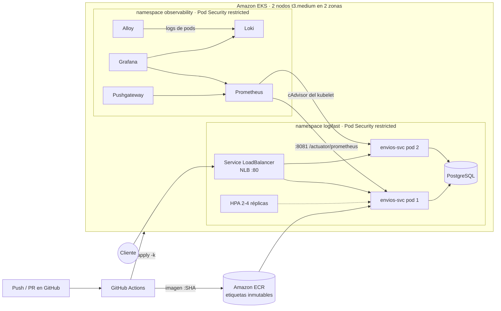

# IE2 — Despliegue orquestado en la nube (Kubernetes · AWS EKS)

Bloque de Martín. Complementa el entorno local de Rocío (Docker Compose), que se mantiene como entorno de validación; el requisito IE2 se cumple con Kubernetes en Amazon EKS.

## Arquitectura



| Componente | Recurso Kubernetes | Propósito |
|---|---|---|
| `envios-svc` | Deployment (2 réplicas), Service ClusterIP, HPA (2–4, CPU 70%), PDB (mínimo 1) | Microservicio de Envíos |
| `envios-svc-public` | Service `LoadBalancer` (NLB de AWS), solo puerto 8080 | Único punto de entrada público (equivale al ALB del diseño Infra-AWS) |
| `postgres` | Deployment + Service + NetworkPolicy | Base de datos de la demostración; solo acepta conexiones de `envios-svc` |
| Prometheus | Deployment + RBAC de solo lectura | Métricas de la app (descubrimiento de pods) y CPU/memoria por pod (cAdvisor del kubelet) |
| Pushgateway | Deployment | Cobertura JaCoCo y duración del despliegue publicadas por el pipeline |
| Loki + Alloy | Deployments + RBAC de solo lectura | Logs centralizados de los pods vía API de Kubernetes (sin hostPath ni socket Docker) |
| Grafana | Deployment | Dashboard `LogiFast - Observabilidad EP3 (Kubernetes)`, adaptado del de Rocío |
| Amazon ECR | Repositorio `logifast-envios` | Imágenes etiquetadas con el SHA, inmutables y con escaneo al subir |

Manifiestos en `deploy/k8s/` (Kustomize):

```
deploy/k8s/
├── base/             namespace, envios-svc (Deployment, Service, HPA, PDB), postgres
├── observability/    Prometheus, Pushgateway, Loki, Alloy, Grafana + configuraciones
└── overlays/
    ├── kind/         clúster efímero de validación en GitHub Actions
    └── eks/          AWS EKS: agrega el Service LoadBalancer público
```

## Configuración aplicada

**Seguridad.** Ambos namespaces aplican Pod Security Standards `restricted`: el clúster rechaza pods que corran como root, escalen privilegios o conserven capacidades. Todos los contenedores usan UID no root, sistema de archivos de solo lectura, `capabilities: drop [ALL]` y seccomp `RuntimeDefault`. El Dockerfile usa ahora un UID numérico (10001) para que Kubernetes pueda verificarlo.

**Secretos.** `envios-db` y `grafana-admin` los genera `scripts/k8s-deploy.sh` con `openssl rand` la primera vez y se conservan en el clúster. No existen en Git. Las credenciales AWS viven en los secretos de GitHub.

**Health checks.** `startupProbe` (hasta 3 min para la JVM), `livenessProbe` y `readinessProbe` sobre `/actuator/health/{liveness,readiness}`. La readiness incluye la base de datos, así que un pod sin conexión deja de recibir tráfico.

**Exposición mínima.** Actuator corre en un puerto interno separado (`MANAGEMENT_SERVER_PORT=8081`). El NLB solo publica el 8080, así que `/actuator/*` responde 404 desde Internet. Prometheus lee el 8081 dentro del clúster. Grafana y Prometheus no tienen IP pública; se abren con `kubectl port-forward`.

**Disponibilidad y recuperación.**
- Rolling update con `maxUnavailable: 0`.
- Réplicas repartidas entre nodos.
- PDB que garantiza al menos un pod durante mantenimientos.
- HPA para escalar por CPU, con metrics-server instalado por el pipeline.
- Kubernetes reinicia los contenedores que fallan la liveness.

**Trazabilidad commit → imagen → despliegue.**
- La imagen se etiqueta con el SHA corto y las etiquetas OCI `revision`/`source`.
- En ECR la etiqueta es inmutable y el pipeline registra el `digest`.
- El ConfigMap `envios-build-info` inyecta commit, versión y URL de la ejecución, visibles en `/actuator/info`.
- El Deployment se anota con `kubernetes.io/change-cause`, de modo que `kubectl rollout history` muestra qué commit y qué ejecución produjo cada revisión.

## Integración en el pipeline

| Job | Cuándo | Qué hace |
|---|---|---|
| `Kubernetes (validación en kind)` | Cada PR y push | Crea un clúster kind efímero, carga la imagen recién construida, aplica `overlays/kind` con `scripts/k8s-deploy.sh` y corre `scripts/verify-k8s.sh` (health, commit, CRUD, exposición, métricas en Prometheus, logs en Loki). Es check obligatorio para integrar. |
| `Deploy cloud (AWS EKS)` | Push a `develop`/`main` o ejecución manual (`workflow_dispatch`), con `CLOUD_DEPLOY_ENABLED=true` | Necesita que **todos** los controles y el entorno simulado estén en verde. Sube la imagen a ECR, despliega `overlays/eks`, verifica dentro del clúster y por el NLB público, publica métricas CI en el Pushgateway del clúster y sube el artefacto `evidencia-eks-<sha7>`. |

## Procedimiento (AWS Academy Learner Lab)

> **Costos.** Mientras el clúster exista se cobra el plano de control EKS, 2 instancias t3.medium y el NLB, aunque el lab esté detenido. Créalo, toma las evidencias y elimínalo el mismo día.

### 1. Crear el clúster (≈20 min)

1. Iniciar el Learner Lab (*Start Lab*), abrir la consola de AWS y verificar que la región sea **us-east-1**.
2. Abrir **CloudShell** y ejecutar:

   ```bash
   # eksctl (una sola vez por sesión de CloudShell)
   curl -sL "https://github.com/eksctl-io/eksctl/releases/latest/download/eksctl_Linux_amd64.tar.gz" | tar xz -C /tmp
   sudo install /tmp/eksctl /usr/local/bin/eksctl
   git clone https://github.com/rocio-mino/LogiFast-Envios.git
   cd LogiFast-Envios
   git switch feature/ep3-martin-cloud-compliance   # o develop, una vez integrado
   ./scripts/eks-cluster.sh create
   ```

   Si `eksctl` falla por permisos IAM del lab, usar la alternativa de consola: EKS → *Create cluster* → *Custom configuration* → rol de clúster `LabRole`, subredes de 2 zonas (no `us-east-1e`). Luego *Compute* → *Add node group* → rol `LabRole`, 2 × t3.medium, disco de 20 GiB.

### 2. Conectar GitHub con el clúster

En GitHub → *Settings* → *Secrets and variables* → *Actions*:

| Tipo | Nombre | Valor |
|---|---|---|
| Secret | `AWS_ACCESS_KEY_ID` | Learner Lab → *AWS Details* → *AWS CLI: Show* |
| Secret | `AWS_SECRET_ACCESS_KEY` | ídem |
| Secret | `AWS_SESSION_TOKEN` | ídem (cambia en cada sesión del lab: actualizar los 3 al iniciarlo) |
| Variable | `CLOUD_DEPLOY_ENABLED` | `true` mientras el clúster exista; `false` al eliminarlo |
| Variable | `AWS_REGION` | `us-east-1` (opcional, es el valor por defecto) |
| Variable | `EKS_CLUSTER_NAME` | `logifast-eks` (opcional) |

Con GitHub CLI: `gh secret set AWS_SESSION_TOKEN` (pega el valor) y `gh variable set CLOUD_DEPLOY_ENABLED --body true`.

### 3. Desplegar

- **Desde la rama de trabajo:** GitHub → *Actions* → *CI/CD - Envios* → *Run workflow* → rama `feature/ep3-martin-cloud-compliance`.
- **Automático:** cada push a `develop` o `main` cuando `CLOUD_DEPLOY_ENABLED=true`.

### 4. Revisar el entorno (CloudShell o terminal con kubectl)

```bash
kubectl get nodes -o wide
kubectl get pods,svc,hpa,pdb -n logifast -o wide
kubectl get pods -n observability
kubectl -n logifast rollout history deployment/envios-svc
kubectl top pods -n logifast
# URL pública del API
kubectl -n logifast get svc envios-svc-public -o jsonpath='{.status.loadBalancer.ingress[0].hostname}'
# Grafana (usuario admin) — contraseña generada:
kubectl -n observability get secret grafana-admin -o jsonpath='{.data.admin-password}' | base64 -d; echo
kubectl -n observability port-forward svc/grafana 3000:3000   # luego abrir http://localhost:3000
```

El `port-forward` de Grafana debe ejecutarse en un equipo con navegador (terminal local con kubectl), no en CloudShell.

Para usar `kubectl` desde Windows: instalar AWS CLI y kubectl, cargar las credenciales del lab (`aws configure` + `aws configure set aws_session_token ...`) y ejecutar `aws eks update-kubeconfig --name logifast-eks --region us-east-1`.

### 5. Evidencias a guardar en `evidencias/EP3/IE2-Despliegue/`

| Archivo sugerido | Contenido |
|---|---|
| `01-eks-cluster-consola.png` | Clúster `logifast-eks` *Active* y node group en la consola de AWS |
| `02-kubectl-nodes-pods.png` | `kubectl get nodes` y `kubectl get pods,svc,hpa -n logifast` |
| `03-api-publica.png` | Navegador o curl contra `http://<NLB>/api/envios` |
| `04-pipeline-deploy-eks.png` | Run de Actions con `Deploy cloud (AWS EKS)` en verde y su resumen (commit, imagen ECR, digest, URL) |
| `05-ecr-imagen-sha.png` | Repositorio ECR con la etiqueta = SHA del commit |
| `06-grafana-eks.png` | Dashboard Kubernetes con datos del clúster EKS |
| `07-rollout-history.txt` | Salida de `kubectl rollout history` (también viene en el artefacto) |
| `08-kind-validacion.png` | Job `Kubernetes (validación en kind)` en verde |
| `evidencia-eks-<sha7>/` | Artefacto descargado del run (JSON de trazabilidad, verificación, métricas, logs) |

### 6. Eliminar los recursos al terminar

```bash
./scripts/eks-cluster.sh delete      # namespaces → NLB, clúster, VPC (CloudFormation) y repositorio ECR
```

Después poner `CLOUD_DEPLOY_ENABLED=false` y verificar en la consola que no queden clústeres EKS, instancias EC2, balanceadores ni volúmenes EBS del proyecto.

## Limitaciones conocidas

- PostgreSQL usa `emptyDir`: los datos se pierden si el pod se reprograma. Es aceptable para la demostración; en producción corresponde Amazon RDS/Aurora, según `docs/diagramas/infraestructura/Infra-AWS.png`.
- Prometheus y Loki guardan datos en `emptyDir` (retención corta).
- La `NetworkPolicy` de PostgreSQL se aplica solo si el clúster tiene habilitado el soporte de network policies (en EKS es una opción del VPC CNI).
- Las credenciales del Learner Lab expiran con la sesión. Si el job falla con “sesión AWS expirada”, hay que iniciar el lab, actualizar los 3 secretos y relanzar el job.
