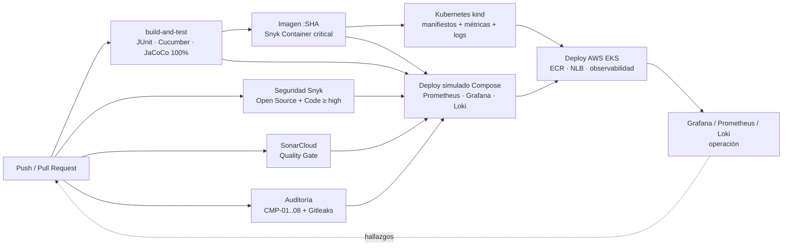

# IE4 — Integración de monitoreo, métricas y seguridad en el pipeline CI/CD

Este documento une el bloque de observabilidad de Rocío (`01`–`04`) con el de nube y cumplimiento de Martín (`06`–`08`). Explica en qué etapa corre cada herramienta, qué pasa cuando falla y qué decisión técnica permite tomar.

## Flujo completo

## Dónde corre cada control y qué ocurre si falla

| Etapa (job) | Herramienta | Señal que produce | Si falla |
|---|---|---|---|
| `build-and-test` | Maven, JUnit, Cucumber, JaCoCo | Pruebas y % de cobertura (artefacto `reportes-pruebas-<sha>`) | No se construye la imagen ni se despliega nada |
| `Seguridad (Snyk)` | Snyk Open Source + Snyk Code | Vulnerabilidades por severidad (SARIF en *Security* y artefacto) | Despliegues *skipped*; merge bloqueado |
| `SonarCloud (Quality Gate)` | SonarCloud | Bugs, vulnerabilidades, code smells, hotspots, cobertura y duplicación del código nuevo | Despliegues *skipped*; merge bloqueado |
| `Auditoría de cumplimiento` | `audit-compliance.py`, Gitleaks | Tabla de políticas CMP y hallazgos de secretos | Despliegues *skipped*; merge bloqueado |
| `Imagen Docker` | Docker + Snyk Container | Imagen etiquetada con el SHA; vulnerabilidades del SO base | La imagen no llega a ningún entorno |
| `Kubernetes (kind)` | kind, `k8s-deploy.sh`, `verify-k8s.sh` | Rollout, probes, commit en ejecución, métricas en Prometheus, logs en Loki | No hay despliegue en la nube |
| `Deploy (entorno simulado)` | Docker Compose, Prometheus, Pushgateway, Grafana, Loki/Alloy | Duración del despliegue, cobertura publicada, métricas HTTP/CPU/memoria | No hay despliegue en la nube |
| `Deploy cloud (AWS EKS)` | EKS, ECR, NLB, misma pila de observabilidad | Registro commit → imagen → digest → URL; métricas en el Prometheus del clúster | Se conserva la versión anterior (rolling update con `maxUnavailable: 0`) |

## Cómo apoyan la toma de decisiones

### Decisiones de integración (antes del merge)

Son automáticas y binarias: el cambio entra solo si todos los checks requeridos están en verde (protección de ramas).

| Pregunta | Fuente | Regla |
|---|---|---|
| ¿El cambio rompe funcionalidad? | Pruebas JUnit/Cucumber | Cualquier falla → no se integra |
| ¿Quedó código sin probar? | JaCoCo (100% de líneas) y SonarCloud (≥ 80% del código nuevo) | Bajo el umbral → agregar pruebas |
| ¿Introduce un riesgo de seguridad? | Snyk (≥ high), Snyk Container (critical), Gitleaks | Hallazgo → actualizar la dependencia o la imagen base, o retirar el secreto (y rotarlo si era real) |
| ¿Degrada la mantenibilidad? | Quality Gate de SonarCloud | `ERROR` → corregir los issues nuevos o revisar los hotspots |
| ¿La configuración cumple las políticas? | `audit-compliance.py` | Incumplimiento → corregir el manifiesto o el workflow |
| ¿Funciona desplegado en Kubernetes? | Job kind | Pod que no arranca, probe en rojo o sin métricas → no se publica en la nube |

### Decisiones de operación (después del despliegue)

Se toman mirando el dashboard de Grafana (Compose o Kubernetes) y las consultas de Prometheus y Loki:

| Señal | Panel / consulta | Decisión |
|---|---|---|
| Disponibilidad < 100% | `avg(up{job="logifast-envios"})` | Revisar los pods afectados (`kubectl describe`, logs en Loki); si coincide con un despliegue nuevo, `kubectl rollout undo` a la revisión anterior, identificada por commit en `rollout history` |
| Aumento de 5xx | Errores HTTP 4xx/5xx | Correlacionar con los logs del mismo intervalo (Loki) y con el commit desplegado (`/actuator/info`) |
| Latencia p95 en alza | Latencia HTTP p95 | Ver CPU y memoria del mismo intervalo: si la CPU se acerca al límite de 0.75 cores, el HPA escala; si se sostiene en el máximo (4), revisar los límites o el código |
| Memoria cerca de 512 MiB | Memoria por pod | Riesgo de OOMKill: revisar `MaxRAMPercentage`, fugas o subir el límite de forma justificada |
| Duración de despliegue creciente | `logifast_deploy_duration_seconds` (etiqueta `environment` = docker-compose, kind o eks) | Revisar el tiempo de arranque de la JVM y las probes; comparar entre entornos |
| Cobertura publicada | `logifast_test_coverage_percent` | Tendencia por commit; complementa el umbral bloqueante |

### Mejora continua

1. **Medir.** Cada ejecución deja métricas (Prometheus/Pushgateway), reportes (JaCoCo, Snyk, SonarCloud, auditoría) y artefactos de evidencia asociados al SHA.
2. **Detectar.** Los umbrales bloquean regresiones. Los dashboards muestran tendencias que no alcanzan a bloquear.
3. **Corregir.**
   - Las vulnerabilidades nuevas llegan como PR de Dependabot, que deben pasar los mismos controles.
   - Las excepciones (`.snyk`) caducan y obligan a revisarlas.
   - Los hotspots se justifican en SonarCloud.
4. **Verificar.** El siguiente run demuestra la corrección con los mismos controles. La trazabilidad commit → imagen → despliegue permite comparar el antes y el después.

## Resultados obtenidos en las validaciones

Valores tomados de las ejecuciones reales (capturas en `evidencias/EP3/`).

| Validación | Ejecución | Resultado |
|---|---|---|
| Pipeline completo en verde (PR #34) | [run 45308943633](https://github.com/rocio-mino/LogiFast-Envios/actions/runs/45308943633) | 10 checks en verde en 4 min 21 s; `Deploy cloud (AWS EKS)` *skipped* por ser PR |
| Quality Gate SonarCloud | mismo run | *Passed*: seguridad y mantenibilidad A, duplicación 0,0 %, hotspots revisados 100 % |
| Auditoría de cumplimiento | mismo run | 71/71 controles cumplidos; Gitleaks 0 hallazgos en todo el historial |
| Snyk Container (critical) | mismo run | Sin vulnerabilidades críticas en la imagen |
| Validación kind | mismo run | `VERIFICACIÓN KUBERNETES EXITOSA`: health, commit, CRUD, exposición, métricas y logs |
| Bloqueo real por seguridad | run del commit `4f7a4bd` (PR #34) | Snyk Open Source: 2 vulnerabilidades *high* en Spring Framework 7.0.9 → job en rojo, deploy *skipped*; corregido con Spring Boot 4.0.10 |
| Bloqueo real por secretos | mismo run | Gitleaks: `leaks found: 2` (regla `curl-auth-user`) → job en rojo, deploy *skipped*; corregido sin excepción |
| Bloqueo por calidad (Rocío) | ver `03_Validacion_Calidad.md` | BUILD FAILURE, deploy *skipped* |
| Deploy EKS, intento 1 (commit `e05d2ce`) | [run 45469040928](https://github.com/rocio-mino/LogiFast-Envios/actions/runs/45469040928) | Aplicación desplegada y respondiendo; verificación en rojo por falso negativo del balanceador (código `000`) |
| Deploy EKS, intento 2 (commit `941bdf1`) | [run 45473434057](https://github.com/rocio-mino/LogiFast-Envios/actions/runs/45473434057) | Éxito: 2 réplicas en 2 nodos, imagen `logifast-envios:941bdf1` (digest `sha256:2e3042c6…`) en ECR, API pública 200 y `/actuator/prometheus` 404, cobertura 100 % y duración visibles en Grafana |
